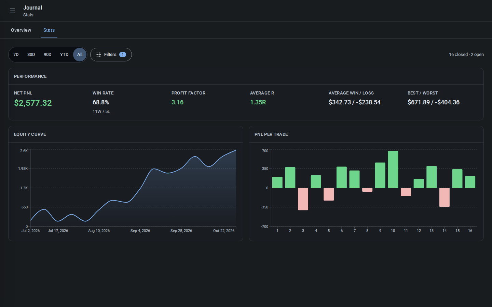
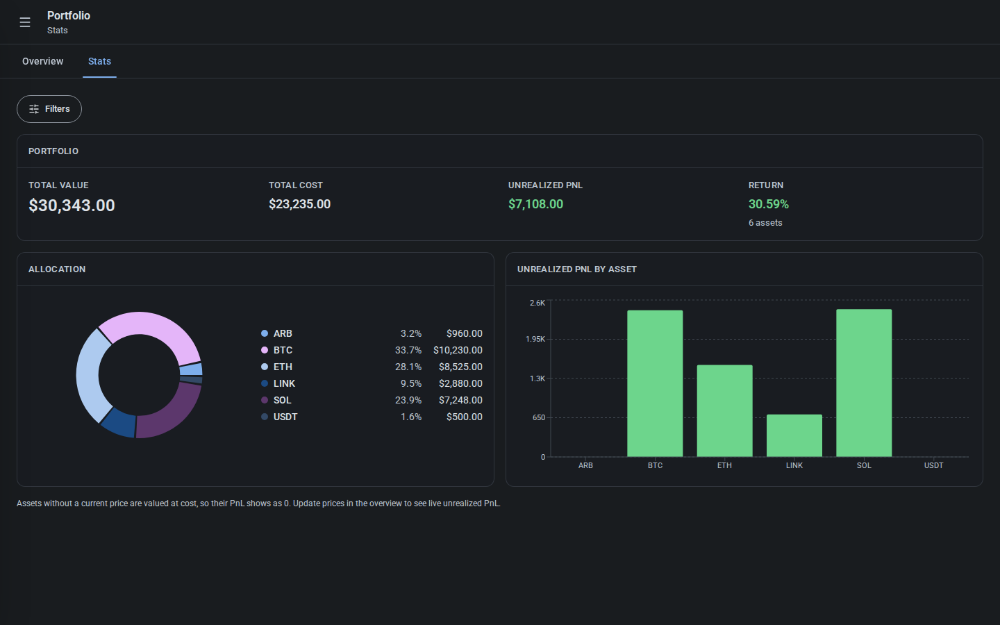
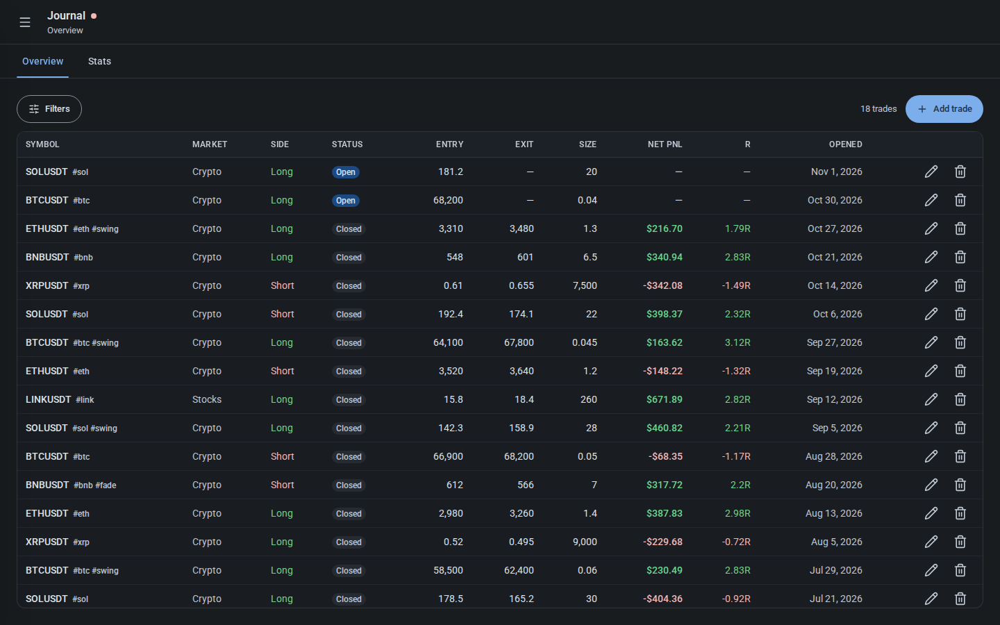
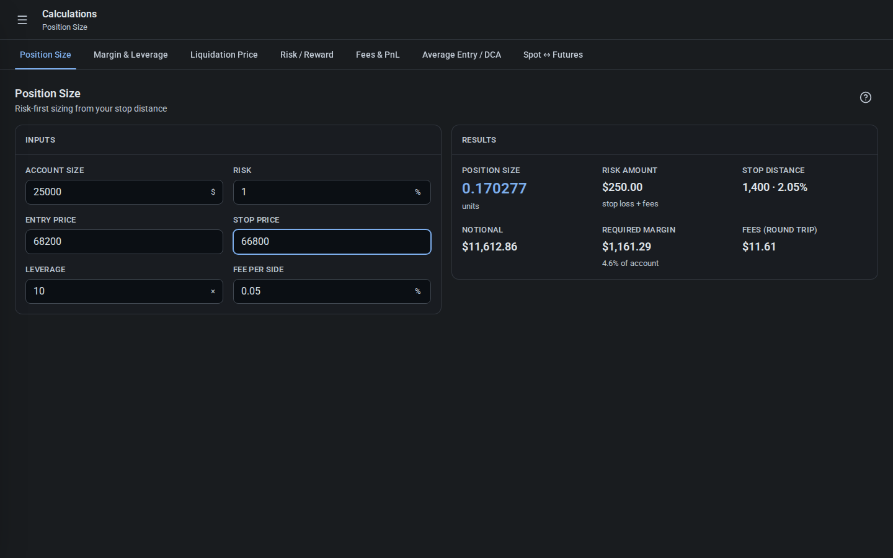
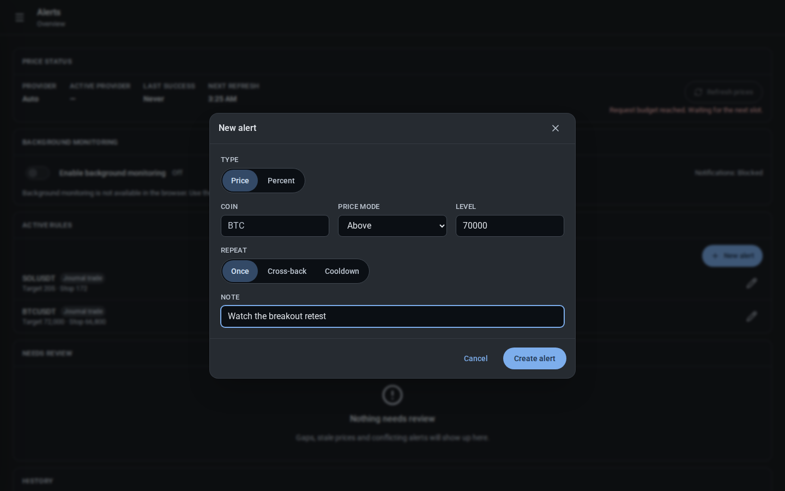
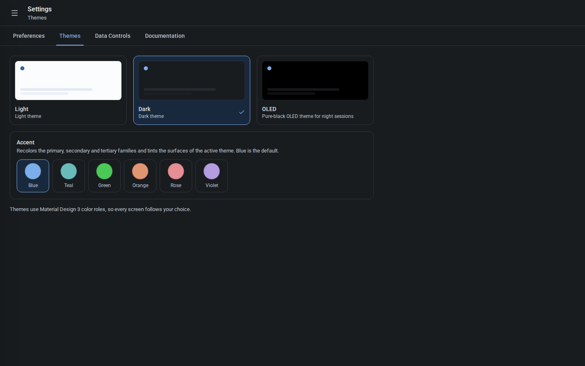

# ClyTrade

[](https://github.com/benyamin-git/ClyTrade/releases)
[](https://github.com/benyamin-git/ClyTrade/releases)
[](LICENSE)

ClyTrade is a local-first trading app: a trade journal, a spot portfolio tracker,
price alerts and seven calculators in one place. It ships as an installable PWA
and as Windows and Android apps built with Tauri v2. Everything runs on the
device, with no account, server or subscription.

Small trading tools are scattered across paid apps, browser tabs and
spreadsheets. ClyTrade keeps the journal, the portfolio and the calculators in
one app and one local database.

> **Status:** early development. V1 covers the offline core; the 0.5 releases add
> optional crypto prices, alerts and auto-close. Expect rough edges and breaking
> changes before `1.0.0`.

## Download

| Platform         | Download                                                                                                                                                                                                                                                                                                             |
| ---------------- | -------------------------------------------------------------------------------------------------------------------------------------------------------------------------------------------------------------------------------------------------------------------------------------------------------------------- |
| Web (PWA)        | [](https://benyamin-git.github.io/ClyTrade/)                                                                                                                                                                                   |
| Windows (64-bit) | [](https://github.com/benyamin-git/ClyTrade/releases) [](https://github.com/benyamin-git/ClyTrade/releases) |
| Android          | [](https://github.com/benyamin-git/ClyTrade/releases)                                                                                                                                                        |

The PWA is the reference platform: it installs from Safari on iPhone and iPad,
and from Chrome or Edge on desktop. Windows builds are unsigned, so SmartScreen
warns on first run. Android APKs are signed with ClyTrade's release key and
install in place over an older release-key build. Windows and Android files live
on the [releases page](https://github.com/benyamin-git/ClyTrade/releases); each
release lists the portable EXE, the installer and the universal APK.

## Screenshots

Captured in the desktop layout with sample data and the Dark theme, at 1440×900.

| Journal stats                                                                            | Portfolio stats                                                                             |
| ---------------------------------------------------------------------------------------- | ------------------------------------------------------------------------------------------- |
|  |  |

| Journal overview                                                                                         | Position Size calculator                                                                |
| -------------------------------------------------------------------------------------------------------- | --------------------------------------------------------------------------------------- |
|  |  |





Regenerate them with `npm run screenshots`; run `npm run screenshots:install`
once first to fetch the Chromium build Playwright uses. The script starts Vite on
`127.0.0.1:5199` (`SCREENSHOTS_PORT` overrides), loads the sample data and
captures each page into `screenshots/desktop/`.

## What's new in v0.5.2

- **Rounded cards keep their corners.** Journal and portfolio tables are clipped
  to the card radius, so the header row no longer paints over the top corners
  when rows are present.

Older changes are in [CHANGELOG.md](./CHANGELOG.md).

## Features

- **Journal** — trades with derived net PnL, R multiples, per-trade stats and
  filterable equity curve and PnL charts; optional auto-close at the exact
  target or stop.
- **Portfolio** — holdings with blended cost basis, manual or automatic crypto
  prices, unrealized PnL and allocation charts.
- **Alerts** — price and percent rules plus every open trade's target and stop,
  with a review queue, 500-event history and grouped OS notifications on Android
  and Windows.
- **Calculators** — Position Size, Margin & Leverage, Liquidation Price, Risk /
  Reward, Fees & PnL, Average Entry / DCA, Spot ↔ Futures.
- **Local-first** — IndexedDB storage, JSON export/import, no account or cloud.
- **Bilingual and themed** — English and Persian (right-to-left), Light / Dark /
  OLED, and six accent palettes.
- **Native wrappers** — Windows tray build and Android app share the same
  frontend; the PWA remains the reference platform.

## Install

### Web

Open <https://benyamin-git.github.io/ClyTrade/>. On iPhone and iPad, use Safari:
**Share → Add to Home Screen**. The installed app runs standalone and offline.

### Windows

Download the portable EXE or the installer from the
[releases page](https://github.com/benyamin-git/ClyTrade/releases). The build is
unsigned; SmartScreen warns about the unknown publisher on first run.

### Android

Download `ClyTrade-<version>-android-universal.apk` from the
[releases page](https://github.com/benyamin-git/ClyTrade/releases) and open it.
Allow installation from your file manager or browser when Android asks. Newer
release-key APKs install in place without losing local data.

## Development

Requires Node 22.12 or newer.

```bash
npm install
npm run dev        # Vite on http://localhost:5173
npm run dev:lan    # 0.0.0.0:7401 (strict; PORT overrides)
./scripts/live.sh  # same server in the background (LIVE_SERVER_PORT overrides)
npm run build      # typecheck, production build and PWA service worker
npm test           # Vitest
npm run typecheck
npm run lint
```

`npm run dev:lan` and `./scripts/live.sh` bind `0.0.0.0:7401` for phone or LAN
testing. `live.sh` logs to `/tmp/clytrade-liveserver.log` and writes its pid to
`/tmp/clytrade-liveserver.pid`.

Pushing a `v*` tag runs lint, typecheck and tests, builds Windows and Android
artifacts, and deploys the PWA to GitHub Pages. All `0.x` tags publish as
pre-releases. Version bumps use `npm run version:set -- <version>`. See
[`AGENTS.md`](./AGENTS.md) for the full command list, architecture and native
signing notes.

## Documentation

The full user documentation is inside the app under **Settings →
Documentation**, with its source in `src/docs/**` in English and Persian. Product
direction and design decisions live in [`masterplan.md`](./masterplan.md).

## Limitations and non-goals

- Not financial advice. ClyTrade does not place orders or connect to an exchange
  account; it only reads public price data when you enable that.
- Calculations are estimates. Exchange formulas, fees and funding rates can
  differ, so verify the numbers before acting on them.
- The Windows build is unsigned. Android builds are signed with the release key.
- Each install has its own storage sandbox, so the PWA, Windows and Android
  builds do not share data. Move data with export and import.
- There is no cloud sync or account.

## AI-assisted development

ClyTrade is written almost entirely by AI. The maintainer directs the work, makes
the product decisions, reviews every change and runs the tests; the code and
documentation are AI-generated. The same statement, with more detail, is in the
app under **Settings → Documentation → AI Usage**.

## License

Copyright (C) 2026 benyamin-git. ClyTrade is free software, licensed under the
**GNU General Public License v3.0**; see [`LICENSE`](./LICENSE) for the full
text. It is distributed without any warranty, without even the implied warranty
of merchantability or fitness for a particular purpose.
